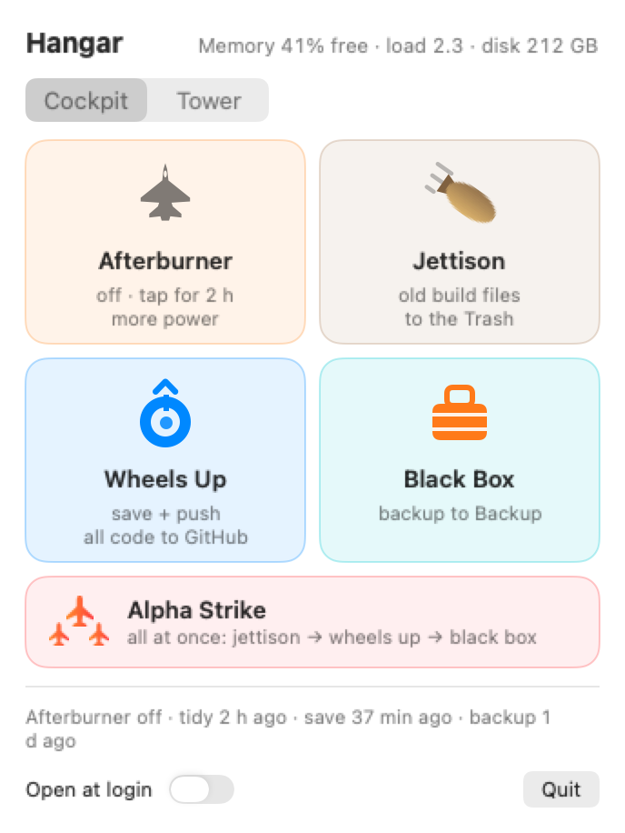
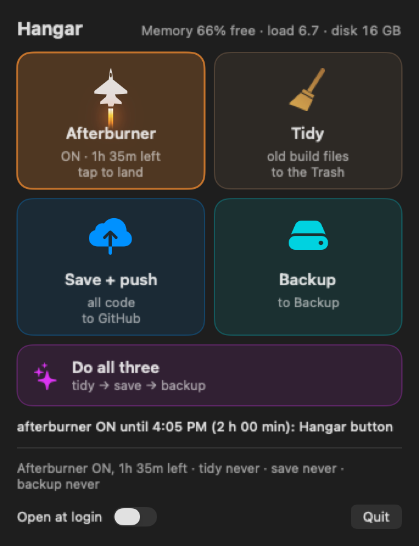
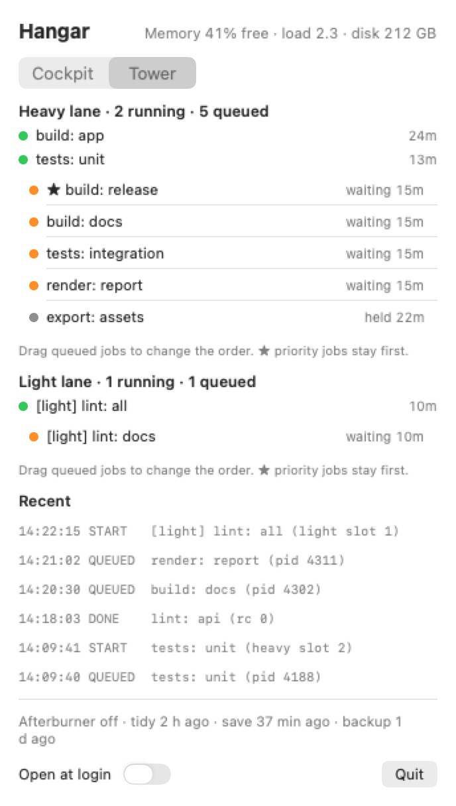
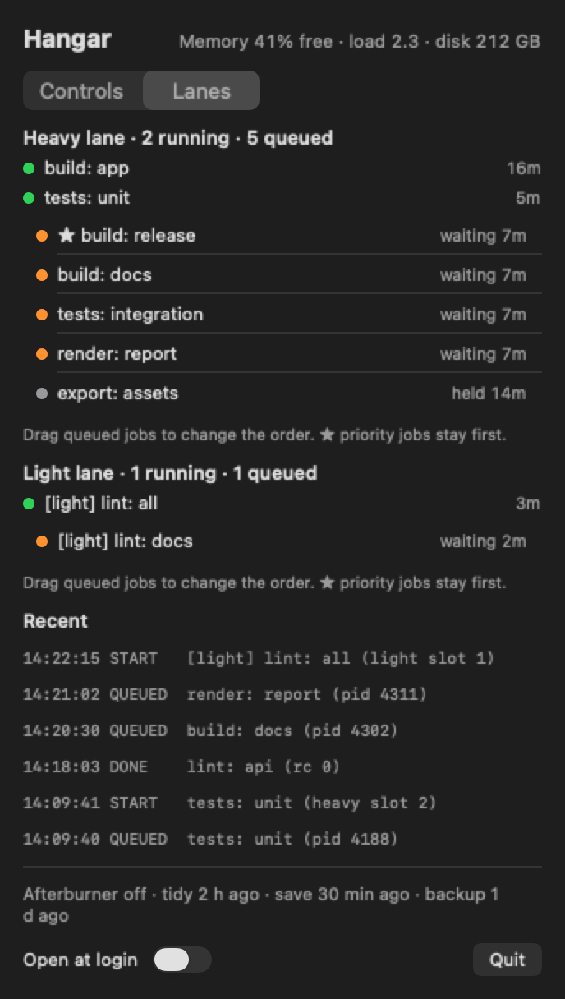

# memguard

A small launchd guard for Macs that run many AI-agent sessions at once: it pauses or stops runaway background jobs before the Mac runs out of RAM, swap or disk, and gives agents a one-at-a-time queue for heavy work.

Made by Tommy Martin. Built while running [ClubPlugins](https://clubplugins.com), where it guards the Mac that runs all our Claude Code sessions.

## Why it exists

Run 20-30 Claude Code sessions on a 24 GB laptop and sooner or later two of them start a training run, a big render or a test suite at the same time. macOS swaps, the disk fills, and the whole machine crashes. memguard is the cheap fix: it watches memory every 15 seconds, only touches jobs that were started by an agent session, and tells the agents (through a rules file) to line up their heavy jobs in a queue.

## What is in the box

| File | What it does |
|---|---|
| `memguard.py` | The guard. One pass per run (launchd runs it every 15 s). Pauses (`SIGSTOP`) the biggest session job when available memory is low, kills it when memory is critical, resumes jobs one by one when memory recovers, stops the lowest-ranked paused job if memory stays low too long, holds new heavy jobs when the disk is nearly full or swap is high while memory is short, alerts you once when a queued job has waited too long, copes with macOS sitting at pressure level 2 for hours, and dispatches the `heavyrun` queue (both lanes, with an optional drag-and-drop `manual_order`, and the timing lane's quiet window). |
| `heavyrun` | Wrapper agents use to run heavy work: `heavyrun "<session>: <job>" <command...>`. Up to 3 jobs at once (memory permitting) plus a light lane for short small jobs. Runs commands with `nice -n 15`. `HEAVY_TIMING=1` adds the timing lane (below); `heavyrun --selftest-timing` is a dry run of it. |
| `afterburner.py`, `afterburner` | Afterburner: `afterburner on 2h` raises the queue caps for a while (more heavy jobs as memory allows, a second light slot, `nice -n 10`) and drops back to normal by itself. |
| `tidy.py`, `tidy` | One step to clean build output to the Trash, push unpushed branches and back up to an attached drive. `tidy --dry-run` shows the plan. |
| `hangar/` | Hangar, an optional SwiftUI menu-bar app with buttons for afterburner, tidy, save and backup (`Hangar.swift`, `build.sh`, `shots/`). |
| `usagegate.py` | The usage-limit prompt (Claude Code plans): asks what to do when weekly usage gets high, and holds the queue if you say so. Called by `memguard.py` every pass and by `heavyrun`. |
| `usage_statusline.py` | Claude Code `statusLine` hook that feeds `usage.json` for `usagegate.py`. |
| `timing_probe.py` | Host-noise probe that `heavyrun` runs before and after a timing job (~10 s each). |
| `config.example.json` | Every threshold and pattern, with defaults for a 24 GB Mac, plus the afterburner settings and the `tidy` block. |
| `rank.example.txt` | Optional job order, plus a `PARK` section for jobs that should always go last. |
| `RULES.md` | A rules block to paste into your agents' standing instructions. |
| `install.sh` | Copies files to `~/.config/memguard`, links `heavyrun`, `afterburner` and `tidy` into `~/.local/bin`, writes the launchd plist, loads it. |
| `launchd/com.example.memguard.plist.template` | The launchd job (every 15 s). |
| `tests/` | Unit tests (dispatcher ordering, rank file, manual order, priority, disk/swap hold, level-2 handling, stuck rule, job detection, light lane, heavyrun, timing lane, usage-limit prompt, graceful stop, afterburner, tidy). No test ever shows a dialog, and the tidy tests run on a scratch home, scratch volumes and a scratch Trash. |
| `CHANGELOG.md` | What changed in each update. |

## Requirements

macOS (uses `vm_stat`, `memory_pressure`, `sysctl`, `top`, `launchctl`, BSD `stat`), the `/usr/bin/python3` that ships with macOS (3.9+), `perl` (ships with macOS; used for a millisecond timestamp). `tidy` also uses `git` and `rsync`; Hangar needs macOS 13+ and the Xcode command line tools to build.

## Install

```bash
git clone <this repo> memguard && cd memguard
python3 -m unittest discover -s tests          # optional: run the tests first
./install.sh                                   # installs to ~/.config/memguard and loads the launchd job
python3 ~/.config/memguard/memguard.py --status
```

`./install.sh --print` shows the launchd plist without installing anything. `./install.sh --uninstall` unloads the job and moves the plist to the Trash. Make sure `~/.local/bin` is on your `PATH` (the installer links `heavyrun` there).

Edit `~/.config/memguard/config.json` to change thresholds. Set `MEMGUARD_HOME` (or `MEMGUARD_CONFIG`) if you want everything somewhere other than `~/.config/memguard`; export it for sessions that call `heavyrun` too.

## Use

```bash
heavyrun "docs-session: render all" python3 render.py          # heavy lane
HEAVY_LIGHT=1 heavyrun "app-session: build" make -j2           # light lane
HEAVY_PRIORITY=1 heavyrun "release: package" ./package.sh      # front of the queue, use sparingly
tail ~/.config/memguard/heavy_queue.log                        # who is running, who is waiting
tail ~/.config/memguard/memguard.log                           # what the guard did and why
python3 ~/.config/memguard/memguard.py --dry-run               # log what it WOULD do, send no signals
```

Then paste `RULES.md` into your global `CLAUDE.md` so the agents actually use the queue.

### What it will and will not touch

It only acts on processes that have a Claude Code session (matched by `session_pattern`) or `heavyrun` as an ancestor. Browsers, the Claude app, Finder, system processes and anything in `protect_pattern` / `protect_extra` are skipped (add your DAW, IDE, etc. to `protect_extra`). Headless browsers started by a session do count as jobs. Killing is a last resort: the biggest session job gets SIGTERM and up to `stop_grace_seconds` (default 30) to save its work, for example a training run writing a checkpoint, then SIGKILL; its queue waiter exits so the session can re-queue it. The grace is 3 s when memory was already under `kill_avail_gb`, and it is cut short if memory falls under `stop_hard_avail_gb`. The log line says whether the job `saved` (exited by itself) or was `forced`.

### Pressure level 2 and manual order

macOS can report memory pressure "warn" (level 2) for hours while several GB are still free. If every level 2 paused the last running job, a paused pile would never restart. So with `level2_one_job` (default on) one job keeps running at level 2 while available memory is above `pause_avail_gb` + `level2_run_margin_gb`, and when nothing is running the smallest paused job is resumed once available memory is above `pause_avail_gb` + `level2_resume_margin_gb`. Set `level2_one_job` to `false` to pause on any level 2.

`manual_order` (optional, in the memguard home folder) lets a UI re-rank the queue: ticket file names from `queue*/` and `queue*_hold/`, one per line (text after whitespace is just a label). Listed tickets swap among the places they already hold in the `rank.txt` order; everything else keeps its place, and new tickets still follow `rank.txt`. Tickets whose label matches `priority_pattern` (default `priority`) and `0-` tickets never move; the stuck rule also stops them last. Set `priority_pattern` to your own label convention, or to `""` for none.

### Timing lane

For honest benchmark numbers on a shared machine. A latency or jitter figure measured while other agent jobs load the Mac can miss its target by a millisecond or more, and the same test passes on a quiet Mac. `HEAVY_TIMING=1 heavyrun ...` runs the job in the heavy lane behind a quiet window and tells the job how noisy the host was.

- **Quiet window.** When a timing job is next in line, no new heavy or light job starts until the other running jobs finish, or until `timing_max_wait_minutes` (default 20) passes; then it starts, and new starts stay held until it ends. Running jobs are never paused or killed for it, and jobs whose label matches `priority_pattern` are never held (the timing job runs beside them). Memory, disk and swap holds still apply.
- **Host baseline.** Just before your command, `timing_probe.py` runs for about 10 s: timer loops at 2.5 ms and 23 ms, measured two ways, plus load average, memory and the other running queue jobs. It runs again after the command. Both summaries go to `heavy_queue.log` (`BASELINE-start`, `BASELINE-end`).
- **What your command sees:**

| Variable | Meaning |
|---|---|
| `HOST_BASELINE_JITTER_P99_MS`, `HOST_BASELINE_JITTER_P50_MS` | How late a no-slack timer (kqueue `NOTE_CRITICAL`) plus 0.2 ms of CPU work finishes. This is host noise: about 0.1 to 0.3 ms p99 on a quiet Mac. |
| `HOST_TIMER_SLACK_P99_MS`, `HOST_TIMER_SLACK_P50_MS` | What a plain `sleep()` gets. macOS coalesces timers for processes started by an agent session, up to 5 ms, even on an idle Mac. That floor is the OS, not load. |
| `HOST_LOADAVG_1M`, `HOST_MEM_FREE_PCT`, `HOST_MEM_PRESSURE_LEVEL` | Load average and memory when the probe ran. |
| `HOST_OTHER_JOBS` | How many other queue jobs were running. |
| `HOST_PRIORITY_RUNNING` | 1 if a job matching `priority_pattern` was running (it is never held, so it can load the host). |
| `HOST_BASELINE_BUSY` | 1 if baseline p99 was above 2 ms, a priority job was running, or the probe failed. Treat the result as inconclusive. |

```bash
HEAVY_TIMING=1 heavyrun "bench: frame loop" python3 bench.py                         # wait up to 20 min for a quiet machine
HEAVY_TIMING=1 HEAVY_TIMING_MAX_WAIT=5 heavyrun "bench: frame loop" python3 bench.py # wait at most 5 min
```

Inside `bench.py`, report your own figure next to the baseline, and call it inconclusive when the host was busy:

```python
import os
p99 = float(os.environ["HOST_BASELINE_JITTER_P99_MS"])
busy = os.environ["HOST_BASELINE_BUSY"] == "1"
print(f"frame jitter p99 {measured:.2f} ms (host noise p99 {p99:.2f} ms)" + ("  INCONCLUSIVE: host busy" if busy else ""))
```

Never loosen a target to make a result pass: report what your code adds on top of the baseline. `heavyrun --selftest-timing` runs the lane end to end in a scratch queue with dummy jobs (about 40 s) and touches no real job.

### Usage-limit prompt (Claude Code plans)

On a Claude subscription the weekly limit can run out in the middle of a busy week, and work then rolls onto paid extra usage without anyone noticing. memguard can ask you first.

**What it does.** `memguard.py` calls `usagegate.py` on every pass. It reads one local file, `usage.json` in the memguard folder (no credentials, no cookies, no network calls). Once per weekly window it shows a macOS dialog, and runs your optional `notify_command` (a phone push, for example), when either:

- weekly usage reaches `usage_threshold_pct` (default 95), or
- paid extra usage starts: weekly usage is at 100 %, or the `extra_spent` figure in `usage.json` rises.

The dialog has three choices and runs in a detached child process, so memguard's memory checks never wait on it:

| Choice | Effect until the weekly reset |
|---|---|
| Keep going on credits | Nothing changes. |
| Pause new agent work until reset | `heavyrun` refuses new jobs (exit code 75 and a clear message), in both lanes. Jobs already waiting in the queue exit 75 too; running jobs finish. |
| Pause heavy jobs only | The heavy lane waits (`heavyrun` holds, the dispatcher starts nothing); the light lane and agents continue. |

Jobs whose queue label matches `priority_pattern` are exempt from both pauses. Your choice is written to `usage_decision.json` and clears itself at the weekly reset. Dismissing the dialog does nothing, and so does leaving it alone: after 10 minutes it closes itself and counts as no action.

**Where `usage.json` comes from.** Claude Code passes `rate_limits.seven_day` and `rate_limits.five_hour` to a `statusLine` command, so the weekly numbers are free. Add the hook to `~/.claude/settings.json` (the hook prints nothing; set `USAGE_STATUSLINE_NEXT` to a command if you already have a status line and want to keep it):

```json
{
  "statusLine": { "type": "command", "command": "/usr/bin/python3 -I ~/.config/memguard/usage_statusline.py" }
}
```

The status line JSON has no extra-usage spend. If you want the "extra usage started" trigger on the spend figure, any script of yours can write it: `usage.json` is the whole interface, and the hook keeps the fields it does not know. All keys are optional:

```json
{"updated": "2026-10-21T17:45:00Z", "weekly_pct": 100.0, "weekly_resets_at": "2026-10-22T12:00:00Z", "five_hour_pct": 0.0,
 "extra_enabled": true, "extra_spent": 12.50, "currency": "USD"}
```

Without a spend feed the prompt still fires at the threshold and at 100 %.

**Config** (`config.json`): `usage_prompt` (true; false turns the whole thing off), `usage_threshold_pct` (95) and `notify_command` (empty). `notify_command` runs through the shell with the message in `$MEMGUARD_MESSAGE`, the title in `$MEMGUARD_TITLE`, and the message on stdin, for example `"curl -s -H \"Title: $MEMGUARD_TITLE\" -d \"$MEMGUARD_MESSAGE\" https://ntfy.sh/your-topic"`. It is used only for this prompt.

```bash
python3 ~/.config/memguard/usagegate.py --status      # usage.json, state and the decision in force
python3 ~/.config/memguard/usagegate.py --dry-run     # print what it would ask, show nothing, send nothing (it does record the trigger)
python3 ~/.config/memguard/usagegate.py --ask-now     # show the dialog now from the current usage.json
python3 ~/.config/memguard/usagegate.py --gate "my-session: job"   # exit 0 go, 75 refuse, 76 heavy lane held
```

Tell your agents about it with `RULES.md` rule 12. For automated tests set `MEMGUARD_NO_DIALOG=1`: no dialog can then be shown, including `--test-dialog`, and the test suite sets it itself.

### Afterburner

Sometimes you want the Mac to work harder for a while: a big batch tonight, a deadline this afternoon. `afterburner on` raises the queue caps for a set time and drops back to normal by itself.

```bash
afterburner on              # 2 hours (afterburner_default_hours)
afterburner on 4h big batch # 4 hours, with a reason for the log
afterburner status          # time left, caps, load, memory, and whether anything would drop it now
afterburner off
```

While it is on:

- The heavy lane may run up to `afterburner_max_heavy` jobs (default: cores - 2, at least 3), but only as many as memory allows: the usual tiers (2nd job at `slot2_avail_gb`, 3rd at `slot3_avail_gb`), then `afterburner_extra_slot_gb` (3) more for each further job.
- The light lane gets `afterburner_light_slots` (2) slots, and `heavyrun` starts commands with `nice -n` `afterburner_nice` (10) instead of 15.
- Agents may use more workers: `afterburner.json` carries `workers_per_agent` = (cores - 2) // running agent sessions, at least 1. `RULES.md` rule 13 tells agents to read it.
- The memory floors never change: pause, kill and resume lines, the disk and swap hold and the stuck rule work exactly as in normal mode.

It drops back to normal (one line in `memguard.log` and a notification) when memory pressure reaches WARN, when the 1-minute load stays above cores x `afterburner_load_factor` (1.5) for `afterburner_load_seconds` (120), on battery below `afterburner_battery_min_pct` (30), when the time is up, or when an app matching `afterburner_drop_apps` comes to the front or starts (empty by default; set it to your DAW or editor, for example `"Ableton Live|Logic Pro"`). If memguard stops running, the caps go back to normal within 2 minutes. Dropping never pauses or stops a running job; new starts simply follow the normal caps again.

### Tidy

Agent sessions leave build folders everywhere. `tidy` is one command that cleans them up, saves your work and backs it up, and it only does what the `tidy` block in `config.json` allows:

```bash
tidy --dry-run              # the plan; nothing changes
tidy                        # clean -> save -> backup -> one summary line
tidy --only clean           # one step (clean | save | backup)
tidy --drive /Volumes/X     # back up to this drive
tidy --status               # one line of JSON (Hangar reads it)
```

1. **Clean.** Under `roots` it looks for regenerable build output: `.pio`, CMake/JUCE/Zephyr build folders (only when git ignores them), `__pycache__`, `.pytest_cache`, PlatformIO toolchain versions no `platformio.ini` names, and ccache over its cap. Everything goes to ONE dated folder in the Trash (`~/.Trash/tidy_<date_time>`) with a `TIDY_MANIFEST.txt` of original paths and sizes. Never `rm`. It skips `protect` paths, any tree edited in the last `recent_minutes` (30), any tree a process has open, any tree a queued or running `heavyrun` job names in its label, git-tracked files, `never_dirs`, virtualenvs, folders starting with `keep_build_prefixes` and build folders a tracked script refers to.
2. **Save.** Runs your `save_command` if you set one, then pushes every local branch with commits not on origin in the `push_repos` (`owner/name` slugs, or `"*"` for every repo under the roots): same branch name, fast-forward only, never forced. New commits that look like they contain a secret (`.env`, keys, common token shapes) are not pushed. Only private repos are pushed unless `push_public_repos` is true.
3. **Backup.** Picks `backup_drive`, or a volume that already holds a `<backup_folder_prefix>*` folder, and writes `<prefix><YYYY-MM-DD>/git_bundles/` (a verified `git bundle --all` per repo) and `files/` (rsync of `backup_sources`, no `--delete`, unchanged files hard-linked to the previous dated folder so they take no new space). It runs as one light-lane `heavyrun` job. It never uses the startup disk, a Time Machine volume, or a volume with one of the `refuse_drive_markers` folders (default `DCIM`, a camera card) unless you name it with `--drive` or approve it once with `tidy --approve-drive /Volumes/X` (remembered by volume UUID). It waits when memory pressure is high.
4. **Report.** One summary line to `log_file` (default `tidy.log` in the memguard folder) and a notification.

Start with `tidy --dry-run` after you fill in the `tidy` block; with the defaults it cleans only `~/Developer`, `~/code` and `~/Work`, pushes nothing and has no backup sources.

### Hangar (menu-bar app)

<p>


</p>

Hangar is a small SwiftUI menu-bar app: click the plane and a panel opens with an F-22 button for afterburner and jet call-signs for the rest: **Jettison** (tidy, a broom), **Wheels Up** (save + push), **Black Box** (backup) and a red-orange **Alpha Strike** button (three jets in a V) that does all three at once. The Cockpit buttons only run `afterburner` and `tidy` and show their result line. Jettison, Black Box and Alpha Strike first show the `--dry-run` plan and wait for one Confirm. The plane in the menu bar shows the time left while afterburner is on.

A segmented Cockpit / Tower picker at the top switches to the **Tower** tab: the heavy and light lanes with their running slots (pid check, run time), the queued and held tickets (priority jobs marked with a star) and the last few `heavy_queue.log` lines, refreshed every 5 seconds while the panel is open. **Drag a queued job** to reorder it: Hangar writes memguard's `manual_order` file (ticket names, one per line), memguard uses it on its next pass, and priority tickets always stay first. The Tower tab reads the memguard directory from `HANGAR_MEMGUARD_DIR`, else `MEMGUARD_HOME`, else `~/.config/memguard`.

<p>


</p>

```bash
hangar/build.sh                 # builds and installs ~/Applications/Hangar.app (an old copy goes to the Trash)
hangar/build.sh --no-install    # build only, into hangar/build (or HANGAR_OUT=<dir>)
```

Needs macOS 13+ and the Xcode command line tools (`swiftc`); no Xcode project. The app is ad-hoc signed, has no network access of its own and needs no admin rights. Clicking the plane opens the panel as a small window kept inside the visible screen area, and opening the app again (Finder or Spotlight) shows it centered, which helps when the menu bar icon is hidden behind the notch. "Open at login" is off until you switch it on in the panel. `HANGAR_TIDY` and `HANGAR_AFTERBURNER` override where it finds the commands (default `~/.local/bin`). `HANGAR_SHOT=<dir>` renders the screenshots in `hangar/shots/` offscreen, without a menu-bar item; the ones here were taken with a sample config and a made-up queue (`HANGAR_MEMGUARD_DIR` pointed at a scratch folder).

### Tuning for your Mac

The defaults suit a 24 GB machine: pause under 6 GB available, kill under 3 GB, resume over 9 GB. On 16 GB try `pause_avail_gb 4`, `kill_avail_gb 2`, `resume_avail_gb 6`, `slot2_avail_gb 8`, `slot3_avail_gb 12`. To force a strict one-at-a-time queue set `max_heavy_jobs` to 1 and `slot2_avail_gb` very high. Run `--dry-run` for a day to see what it would have done.

## Scramble

`scramble on [8h] [reason]`, `scramble off`, `scramble status`. A standing order for an orchestrating agent session (e.g. Claude Code):
keep every agent slot filled. The target defaults to 20 (Claude Code's concurrent-subagent cap; `SCRAMBLE_TARGET` changes it), and
the session refills each slot from the newest `AGENT_QUEUE_*.md` in `SCRAMBLE_QUEUE_DIR` (default `~/.config/memguard`) as agents
finish. Afterburner gives the machine more muscle (heavy-lane caps); Scramble keeps all agent slots busy. Memory floors and every
memguard rule stay as they are. It turns itself off when the time is up. Hangar has a Scramble tile.

## Known limits

- Pausing a job keeps its memory; macOS can swap it out, but it is not freed. That is what the "stuck" rule is for.
- Memory numbers come from macOS tools whose output could change between OS versions; `--status` is a quick check.
- It is a safety net, not a scheduler. Agents still need to follow `RULES.md`.

## Licence

MIT. See `LICENSE`.

## Autosave every 5 minutes

Set `MEMGUARD_AUTOSAVE_CMD` in the launchd job's environment to a command that snapshots or commits your work (for example, a script that
commits each repo's working tree to an autosave branch). memguard starts it in the background every `MEMGUARD_AUTOSAVE_SECS` (default 300).
The command should take its own lock so overlapping runs exit quietly. Agents should still write partial results to disk as they go.
